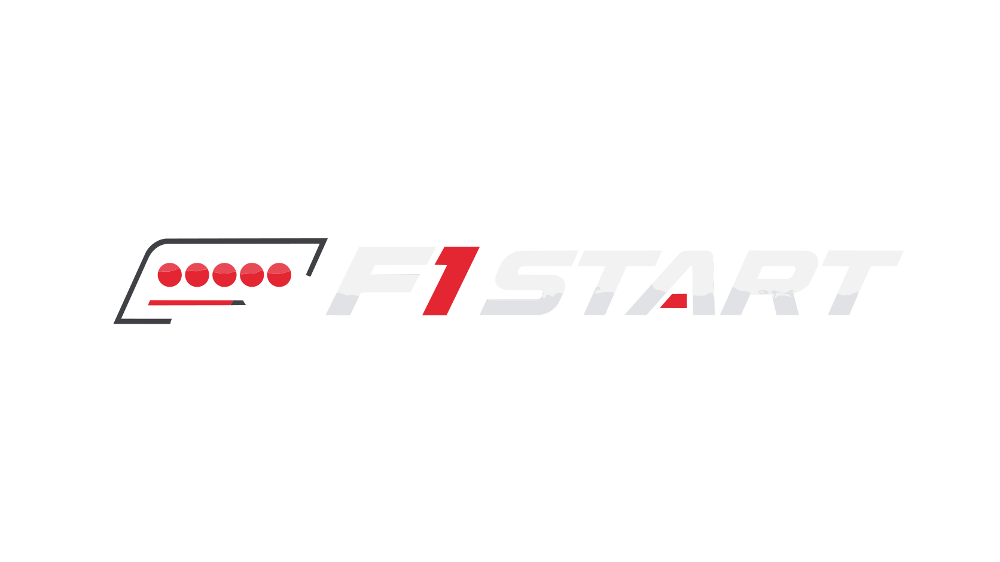

# F1 Start Dashboard

<div align="center">



</div>

Site de Fórmula 1 para iniciantes, com dashboard interativo, calendário de corridas, classificação e glossário de termos da modalidade.

## ✨ Visão geral

O F1 Start Dashboard foi pensado para quem está começando no universo da Fórmula 1 e quer entender, de forma simples e visual, o que acontece durante uma temporada.

O projeto reúne:

- dashboard da próxima etapa
- classificação de pilotos e construtores
- guia de termos usados na transmissão
- explicações sobre pneus, bandeiras, setores e penalidades
- calendário com circuitos e informações das provas

## 🏎️ O que você encontra no projeto

### Dashboard da temporada
- Próxima corrida em destaque
- Horários e sessões do fim de semana
- Informações do circuito atual
- Classificação dinâmica de pilotos e equipes

### Conhecendo a F1
- Glossário com termos da transmissão
- Explicações sobre DRS, bandeiras, pneus e regras
- Cores de setor e penalidades
- Conteúdo educativo voltado para iniciantes

## 🛠️ Tecnologias utilizadas

- HTML5
- CSS3
- JavaScript
- Fetch API para consumir dados da F1 em tempo real
- Ícones Lucide
- Layout responsivo e visual focado em dashboards esportivos

## 📁 Estrutura do projeto

```text
F1WebSite/
├── app.js
├── index.html
├── styles.css
├── README.md
├── assets/
│   ├── Logo.svg
│   ├── Kimi.jpg
│   └── circuits/
├── Logo.svg
└── ...
```

## ▶️ Como executar

### Opção 1: abrir diretamente no navegador
Basta abrir o arquivo `index.html` no navegador.

### Opção 2: usar um servidor local
No terminal, na pasta do projeto, execute:

```bash
python -m http.server 8000
```

Depois acesse:

```text
http://localhost:8000
```

## 🌐 Dados e fontes

O projeto utiliza dados da API de Fórmula 1 da Jolpica, com fallback local para manter o site funcional mesmo quando a API não responde.

## 🎯 Objetivo

A ideia do projeto é tornar a Fórmula 1 mais acessível para pessoas que estão começando, com conteúdo simples, visual moderno e informações que ajudam a acompanhar corridas, regras e estratégias com mais facilidade.

## 📝 Observação

Este projeto ainda não possui uma licença definida explicitamente no repositório.

---

Feito com paixão pelo esporte e pensado para quem quer entender a F1 desde o começo.
